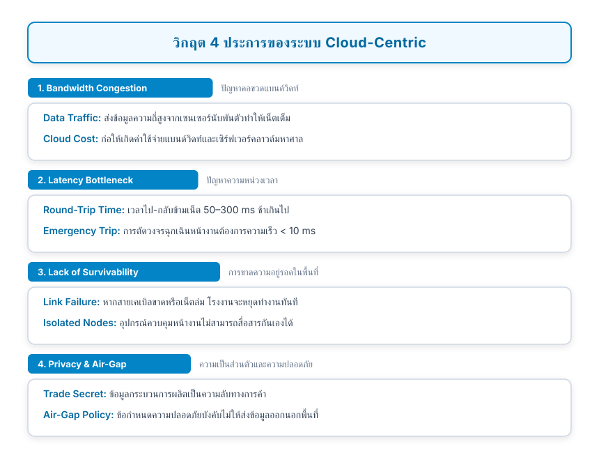
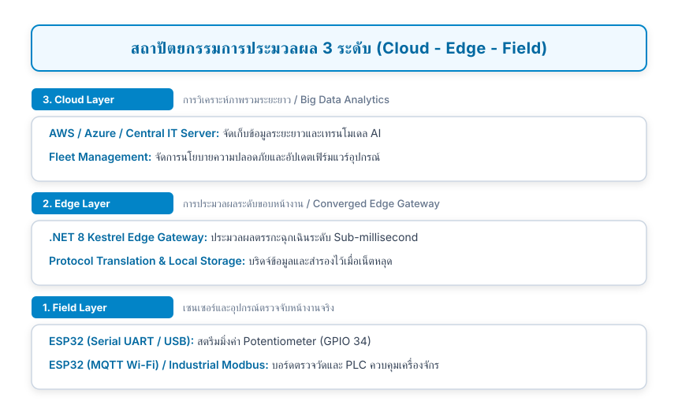
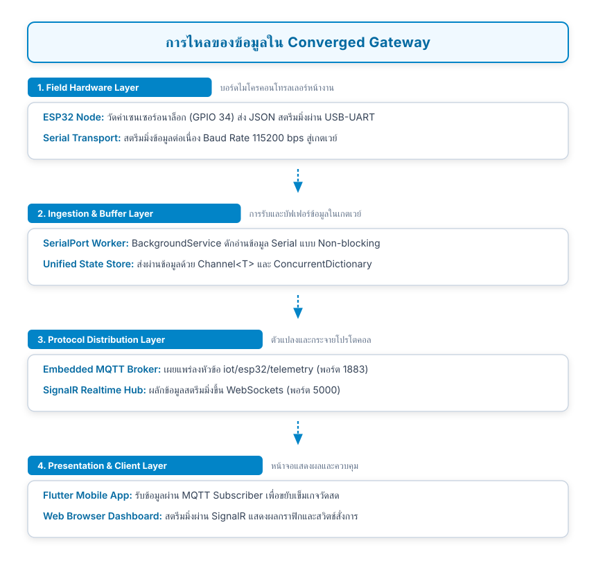

# 13.1 สถาปัตยกรรม Edge Computing และ Converged Gateway 

---

## 13.1.1 การเปลี่ยนกระบวนทัศน์จาก Cloud-Centric สู่ Edge Computing 

ในช่วงยุคแรกเริ่มของระบบ Internet of Things สถาปัตยกรรมส่วนใหญ่เป็นแบบ **Cloud-Centric (พึ่งพาคลาวด์เป็นศูนย์กลาง)** ซึ่งอุปกรณ์เซนเซอร์ทุกตัวจะยิงข้อมูลดิบตรงขึ้นสู่เซิร์ฟเวอร์บนคลาวด์ แม้ว่าวิธีนี้จะง่ายในการเริ่มต้น แต่เมื่อระบบขยายขนาดสู่ระดับอุตสาหกรรม (Industrial IoT) หรือระบบอาคารอัจฉริยะ (Smart Facility) สถาปัตยกรรมแบบ Cloud-Centric ก่อให้เกิดข้อจำกัดรุนแรง 4 ประการ

<b></b> วิกฤต 4 ประการของระบบ Cloud-Centric

เพื่อแก้ปัญหาดังกล่าว โลกวิศวกรรมจึงก้าวเข้าสู่กระบวนทัศน์ **Edge Computing (การประมวลผล ณ ขอบเครือข่าย)** ซึ่งย้ายการคัดกรองข้อมูล การประมวลผลตรรกะ และการควบคุมมาไว้ที่ **Edge Gateway** ที่ติดตั้งอยู่หน้างานจริง

<b></b> สถาปัตยกรรมการประมวลผล 3 ระดับ (Cloud - Edge - Field Layer)

---

## 13.1.2 ปัญหาความหลากหลายของโปรโตคอล 

ความท้าทายที่ยากที่สุดในการผสานระบบไอโอทีหน้างาน คือ **"ไม่มีโปรโตคอลใดที่เหมาะสมกับทุกสิ่ง"** (No One-Size-Fits-All Protocol)

* **Hardware Serial (UART / RS-485)** 
  
  มีความเสถียรสูงสุด ไม่ต้องพึ่งพาเครือข่ายไร้สาย เหมาะกับเครื่องจักรและเซนเซอร์ระยะใกล้ แต่ส่งข้อมูลได้ทีละจุด (Point-to-Point)

* **MQTT** 
  
  ยอดเยี่ยมสำหรับเครือข่ายไร้สายที่แบนด์วิดท์จำกัด รองรับ Publish/Subscribe แต่ต้องการ Broker ส่วนกลาง

* **HTTP REST**
  
  เป็นมาตรฐานสากลที่ทุกระบบ IT เข้าใจง่าย แต่มี Overhead สูงและไม่เหมาะกับการผลักข้อมูลเรียลไทม์

* **WebSockets / SignalR**
  
  เหมาะสำหรับการสตรีมมิ่งข้อมูลขึ้นหน้าจอผู้ใช้งานแบบสองทาง แต่กินสเปกหน่วยความจำสูง ไม่เหมาะกับไมโครคอนโทรลเลอร์ขนาดเล็ก

หากไม่มีตัวกลาง อุปกรณ์เหล่านี้จะไม่สามารถพูดคุยภาษาเดียวกันได้

---

## 13.1.3 นิยามของ Converged Multi-Protocol Edge Gateway

**Converged Edge Gateway (เกตเวย์รวมศูนย์อเนกประสงค์)** คือระบบคอมพิวเตอร์ระดับขอบ (เช่น อุตสาหกรรม PC, Raspberry Pi หรือคอมพิวเตอร์เซิร์ฟเวอร์ประจำสถานี) ที่รันซอฟต์แวร์สแตกพิเศษ สามารถเข้าใจและสื่อสารได้หลายโปรโตคอลพร้อมๆ กัน โดยทำหน้าที่ดังต่อไปนี้

1. **Universal Protocol Bridge (สะพานแปลงโปรโตคอลสากล)** 
   
   แปลงข้อมูลจากแพ็กเก็ต Serial ไหลเข้าสู่หัวข้อ MQTT และแปลงข้อความ MQTT ออกเป็นสตรีมมิ่ง WebSocket ไปยังหน้าเว็บโดยอัตโนมัติ
   
1. **Local Message Arbiter (ผู้ตัดสินและกระจายข้อความท้องถิ่น)** 
   
   ทำหน้าที่เป็น Embedded Broker ภายในตัวเอง ทำให้อุปกรณ์ไอโอทีในโรงงานคุยกันได้โดยไม่ต้องมีอินเทอร์เน็ตออกสู่ภายนอก
   
1. **Local Survivability Engine (ระบบคงอยู่รอดในท้องถิ่น)** 
   
   ทำหน้าที่ควบคุมตรรกะฉุกเฉินและบันทึกข้อมูลสำรองไว้ในหน่วยความจำหรือ Local Database หากระบบคลาวด์ล่ม เมื่ออินเทอร์เน็ตกลับมาจึงค่อยส่งข้อมูลย้อนหลังขึ้นไป (Store-and-Forward)

<b></b> ผังการไหลของข้อมูลและการแปลงโปรโตคอลใน Converged Edge Gateway

---

## 13.1.4 ทำไมต้องเลือก .NET 8 และ Kestrel สำหรับงาน Edge Gateway?

ในการพัฒนา Edge Gateway ยุคใหม่ วิศวกรชั้นนำเลือกใช้ **.NET 8 (LTS)** ควบคู่กับเว็บเซิร์ฟเวอร์ **Kestrel** ด้วยเหตุผลเชิงวิศวกรรมที่เหนือชั้น

1. **ประสิทธิภาพความเร็วระดับหัวแถว (Top-Tier Performance)**
   
   Kestrel ได้รับการจัดอันดับบน TechEmpower Benchmarks ว่าเป็นหนึ่งในเว็บเซิร์ฟเวอร์ที่เร็วที่สุดในโลก รองรับมากกว่า 7 ล้านคำขอต่อวินาที
   
1. **ข้ามแพลตฟอร์มอย่างแท้จริง (True Cross-Platform)**
   
   สามารถคอมไพล์เป็นไบนารีเดียว (Single-file Native AOT) รันได้ทั้งบน Windows 11, Linux (Ubuntu, Debian), และบอร์ดประมวลผล ARM64 เช่น Raspberry Pi 4/5
   
1. **ระบบการประมวลผลเบื้องหลังแบบ Multi-Threading ที่สมบูรณ์แบบ** 
   
   ด้วยสถาปัตยกรรม `BackgroundService`, `Task Parallel Library (TPL)` และ `System.Threading.Channels` ช่วยให้เกตเวย์สามารถดักฟังพอร์ต Serial และจัดการ Socket พันรายการพร้อมกันได้อย่างราบรื่นโดยไม่เกิด Race Condition
