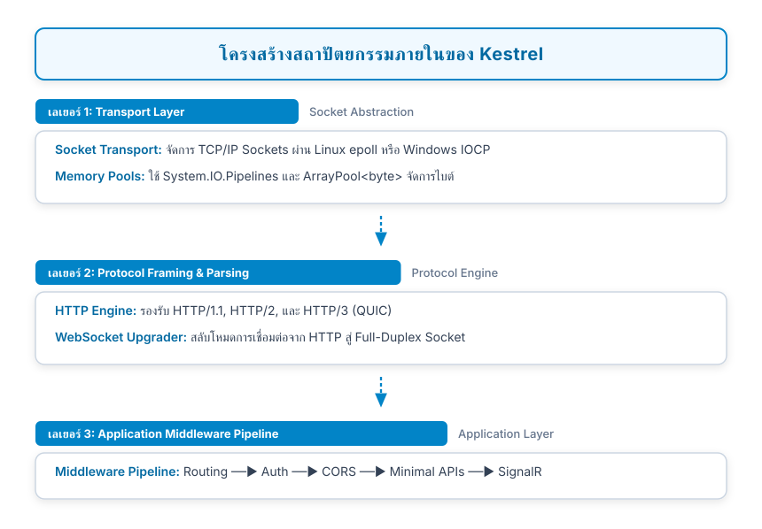
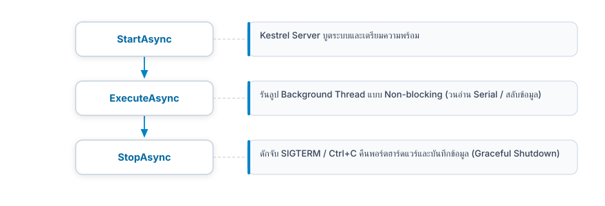
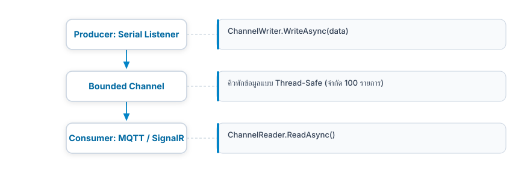

# 13.2 สถาปัตยกรรม Kestrel และงานเบื้องหลังแบบ Concurrency

---

## 13.2.1 เจาะลึกเอนจินภายในของ Kestrel ใน .NET 8 

**Kestrel** คือเว็บเซิร์ฟเวอร์แบบ Asynchronous I/O ประสิทธิภาพสูงที่สร้างขึ้นบนเทคโนโลยี Managed Sockets ของ .NET โดยมีสถาปัตยกรรมภายในแบ่งออกเป็น 3 เลเยอร์หลัก

<p align="center"></p>
<p align="center"><b></b> โครงสร้างสถาปัตยกรรม 3 เลเยอร์ภายในของเอนจิน Kestrel (.NET 8)</p>


### การจัดการหน่วยความจำแบบ Zero-Allocation ด้วย `System.IO.Pipelines`
ในงานไอโอทีที่เกตเวย์ต้องรับแพ็กเก็ตจากเซนเซอร์หลายร้อยรายการต่อวินาที ปัญหาคลาสสิกของภาษาที่มี Garbage Collector (GC) คือ **GC Pause (จังหวะที่ระบบหยุดเพื่อเก็บขยะในหน่วยความจำ)**  
Kestrel แก้ปัญหานี้โดยใช้ **`System.IO.Pipelines`** และ **`ArrayPool<byte>`**
* ไบต์ข้อมูลเครือข่ายจะถูกอ่านลงในบัฟเฟอร์หน่วยความจำที่ยืมมาจาก Pool ส่วนกลาง
* ประมวลผลข้อมูลผ่านโครงสร้าง **`ReadOnlySpan<byte>`** โดยไม่มีการจัดสรรก้อนหน่วยความจำใหม่ (No Heap Allocation)
* เมื่อส่งหรืออ่านเสร็จ จะคืนหน่วยความจำกลับเข้า Pool ทันที ทำให้ Kestrel มีเสถียรภาพและไม่เกิดอาการกระตุกจาก GC แม้รันติดต่อกันหลายเดือน

---

## 13.2.2 การสร้างงานเบื้องหลังระยะยาวด้วย `BackgroundService`

ในแอปพลิเคชัน Edge Gateway เราจำเป็นต้องมีกระบวนการที่ทำงานอยู่เบื้องหลังอย่างต่อเนื่อง (Long-Running Background Tasks) เช่น
1. การเปิดพอร์ตสื่อสารอนุกรม (Serial Port) ค้างไว้เพื่อรอรับไบต์ข้อมูลจาก ESP32
2. การดูแลการเชื่อมต่อของ Embedded MQTT Broker
3. การคำนวณค่าเฉลี่ยทางสถิติและตรวจสอบขีดจำกัดวิกฤต (Threshold Alarming)

ใน ASP.NET Core เราใช้งานผ่านคลาส **`BackgroundService`** ซึ่งสืบทอดมาจากอินเทอร์เฟซ `IHostedService`

<p align="center"></p>
<p align="center"><b>รูปที่ 2</b> วงจรชีวิตและการจัดการเธรดเบื้องหลังของ BackgroundService ใน ASP.NET Core</p>

### ตัวอย่างโครงสร้างคลาส `BackgroundService`
```csharp
public class SerialGatewayWorker : BackgroundService
{
    private readonly ILogger<SerialGatewayWorker> _logger;

    public SerialGatewayWorker(ILogger<SerialGatewayWorker> logger)
    {
        _logger = logger;
    }

    protected override async Task ExecuteAsync(CancellationToken stoppingToken)
    {
        _logger.LogInformation("Serial Gateway Worker Starting...");

        while (!stoppingToken.IsCancellationRequested)
        {
            // ตรรกะการดักฟังฮาร์ดแวร์
            await Task.Delay(100, stoppingToken);
        }

        _logger.LogInformation("Serial Gateway Worker Stopped");
    }
}
```

---

## 13.2.3 การส่งต่อข้อมูลแบบ Thread-Safe ด้วย `System.Threading.Channels`

เมื่อมี Worker หลายตัวทำงานคู่ขนานกัน (เช่น ตัวอ่าน Serial กำลังป้อนข้อมูล ขณะที่ SignalR Hub กำลังดึงข้อมูลไปแสดงบนเว็บ) หากใช้ `List<T>` แบบธรรมดาจะเกิดข้อผิดพลาดรุนแรงเรื่อง **Race Condition**

แนวทางปฏิบัติที่ดีที่สุดใน .NET ยุคใหม่คือการใช้ **`System.Threading.Channels`** ซึ่งเป็นโครงสร้างคิวแบบ **Producer-Consumer** ที่มีประสิทธิภาพสูงและปราศจากการ Lock เธรด

<p align="center"></p>
<p align="center"><b></b> การส่งผ่านข้อมูลแบบ Thread-Safe ระหว่าง Producer และ Consumer ผ่าน System.Threading.Channels</p>

### การสร้าง Channel สำหรับไปป์ไลน์ข้อมูลเซนเซอร์
```csharp
// สร้างคิวแบบ Bounded (จำกัดความจุ 500 รายการ ป้องกันหน่วยความจำล้น)
var telemetryChannel = Channel.CreateBounded<SensorDataPoint>(new BoundedChannelOptions(500)
{
    FullMode = BoundedChannelFullMode.DropOldest // หากคิวเต็ม ให้ทิ้งค่าเก่าสุด
});

// ฝั่งผู้ป้อนข้อมูล (Producer)
await telemetryChannel.Writer.WriteAsync(new SensorDataPoint(1.65, 2048));

// ฝั่งผู้บริโภคข้อมูล (Consumer)
await foreach (var item in telemetryChannel.Reader.ReadAllAsync(cancellationToken))
{
    // นำ item ไปส่งต่อยัง MQTT หรือ WebSockets
}
```

---

## 13.2.4 คลังสถานะร่วมกันในหน่วยความจำ (Unified Thread-Safe State Store)

เพื่อให้อินเทอร์เฟซ REST API สามารถตอบกลับสถานะล่าสุดของอุปกรณ์ได้ทันทีในระดับ Sub-millisecond เกตเวย์จะเก็บสถานะของระบบไว้ในคลาส **`GatewayStateStore`** ที่ขับเคลื่อนด้วย `ConcurrentDictionary`

```csharp
using System.Collections.Concurrent;

public class GatewayStateStore
{
    // จัดเก็บสถานะของอุปกรณ์แต่ละตัวแบบ Thread-safe
    private readonly ConcurrentDictionary<string, object> _states = new();

    public void SetState(string key, object value)
    {
        _states.AddOrUpdate(key, value, (k, oldVal) => value);
    }

    public T? GetState<T>(string key)
    {
        return _states.TryGetValue(key, out var val) && val is T typedVal ? typedVal : default;
    }

    public IDictionary<string, object> GetAll() => _states;
}
```
