# 13.4 ความทนทานระดับขอบและความปลอดภัยของเกตเวย์ (Edge Resilience & Gateway Security)

---

## 13.4.1 การอยู่รอดและการบัฟเฟอร์ข้อมูลยามออฟไลน์ (Local Survivability & Store-and-Forward)

ในระบบไอโอทีระดับภารกิจวิกฤต (Mission-Critical IoT) กฎเหล็กข้อแรกคือ **"เกตเวย์ต้องทำงานต่อไปได้แม้เครือข่ายอินเทอร์เน็ตภายนอกจะตัดขาด (Zero Cloud Dependency for Local Operations)"**

<p align="center"></p>
<p align="center"><b></b>การอยู่รอดและการบัฟเฟอร์ข้อมูลยามออฟไลน์</p>

### รูปแบบการจัดเก็บบัฟเฟอร์ด้วย SQLite ใน .NET
เมื่อสัญญาณขาดหาย เกตเวย์จะบันทึกแพ็กเก็ตข้อมูลลงฐานข้อมูล SQLite ในเครื่อง:
```csharp
public class LocalTelemetryBuffer
{
    private readonly string _dbPath = "Data Source=edge_buffer.db";

    public async Task EnqueueTelemetryAsync(double voltage, int raw, DateTime timestamp)
    {
        using var conn = new SqliteConnection(_dbPath);
        await conn.OpenAsync();
        var cmd = conn.CreateCommand();
        cmd.CommandText = @"
            INSERT INTO OfflineBuffer (Voltage, RawAdc, Timestamp, IsSynced) 
            VALUES ($v, $r, $t, 0);";
        cmd.Parameters.AddWithValue("$v", voltage);
        cmd.Parameters.AddWithValue("$r", raw);
        cmd.Parameters.AddWithValue("$t", timestamp.ToString("o"));
        await cmd.ExecuteNonQueryAsync();
    }
}
```

---

## 13.4.2 รูปแบบ Circuit Breaker และกลยุทธ์กู้คืนระบบ (Fault Tolerance & Circuit Breaker)

เมื่อเกตเวย์ต้องส่งข้อมูลต่อไปยัง Cloud API หรือเซิร์ฟเวอร์ภายนอก หากเซิร์ฟเวอร์ปลายทางล่ม การกระหน่ำส่งคำขอซ้ำๆ จะทำให้เธรดในเกตเวย์ค้างและหมดไป (Thread Starvation)

เราจึงนำรูปแบบ **Circuit Breaker (ตัวตัดวงจรอัตโนมัติ)** มาประยุกต์ใช้:
* **Closed (วงจรปิด/ปกติ)**: คำขอส่งผ่านไปยังคลาวด์ได้ตามปกติ
* **Open (วงจรเปิด/ตัดการทำงาน)**: หากส่งล้มเหลวติดต่อกันเกิน 5 ครั้ง เกตเวย์จะหยุดส่งไปคลาวด์ชั่วคราวเป็นเวลา 30 วินาที และนำข้อมูลเก็บลง Local Buffer ทันที
* **Half-Open (กึ่งเปิดเพื่อทดสอบ)**: เมื่อครบ 30 วินาที จะลองส่งคำขอทดสอบ 1 รายการ หากสำเร็จจะสลับกลับเป็น Closed แต่หากล้มเหลวจะเปิดวงจรตัดต่อ

---

## 13.4.3 การป้องกันการโจมตีและการจำกัดอัตราคำขอ (Edge Rate Limiting)

อุปกรณ์ Edge Gateway มักมีทรัพยากรซีพียูและแรมที่จำกัด จึงมีความเสี่ยงที่จะถูกโจมตีแบบ Denial-of-Service (DoS) จากอุปกรณ์ที่ติดมัลแวร์ในวงแลน

ใน ASP.NET Core (.NET 8) เราสามารถเปิดใช้งาน **Rate Limiting Middleware** เพื่อจำกัดจำนวนคำขอ:

```csharp
using System.Threading.RateLimiting;
using Microsoft.AspNetCore.RateLimiting;

builder.Services.AddRateLimiter(options =>
{
    // กำหนดให้แต่ละ IP Address เรียก API ได้ไม่เกิน 20 ครั้งต่อวินาที
    options.AddPolicy("FixedEdgePolicy", httpContext =>
        RateLimitPartition.GetFixedWindowLimiter(
            partitionKey: httpContext.Connection.RemoteIpAddress?.ToString() ?? "unknown",
            factory: partition => new FixedWindowRateLimiterOptions
            {
                PermitLimit = 20,
                Window = TimeSpan.FromSeconds(1),
                QueueLimit = 5
            }));
});

// ผูกเข้ากับ Route API
app.MapGet("/api/telemetry/latest", () => { /* ... */ })
   .RequireRateLimiting("FixedEdgePolicy");
```

---

## 13.4.4 การยืนยันสิทธิ์ด้วย API Key Middleware (Lightweight Edge Authentication)

สำหรับอุปกรณ์ Edge Gateway ในวงแลน การใช้ระบบ OAuth2 หรือ JWT อาจซับซ้อนเกินไป แนวทางมาตรฐานอุตสาหกรรมคือการใช้ **API Key** ใน HTTP Header:

```csharp
app.Use(async (context, next) =>
{
    // ตรวจสอบเฉพาะเส้นทางคำสั่งสั่งการ /api/actuator
    if (context.Request.Path.StartsWithSegments("/api/actuator"))
    {
        if (!context.Request.Headers.TryGetValue("X-Api-Key", out var extractedApiKey) ||
            extractedApiKey != "SecretEdgeKey2569")
        {
            context.Response.StatusCode = 401; // Unauthorized
            await context.Response.WriteAsync("⛔ ปฏิเสธการเข้าถึง: ต้องการ X-Api-Key ที่ถูกต้อง");
            return;
        }
    }
    await next();
});
```
