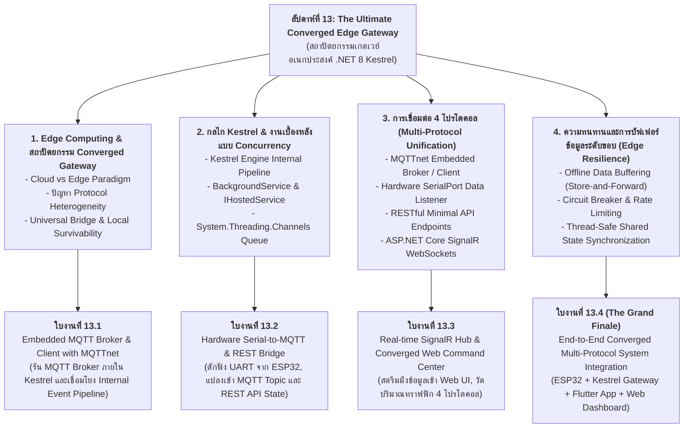

# Week 13: The Ultimate Converged Edge Gateway & System Integration (.NET 8 Kestrel)

## 1. บทนำ (Introduction: The Grand Finale)

ยินดีต้อนรับสู่ **สัปดาห์ที่ 13: บทเรียนสุดท้ายอันเป็นบทสรุปสูงสุด (The Grand Finale)** ของรายวิชาการพัฒนาแอปพลิเคชันไอโอที (IoT Application Development) ตลอด 12 สัปดาห์ที่ผ่านมา เราได้เดินทางผ่านทุกมิติของโลกไอโอที:
* เริ่มจากการตรวจวัดและสอบเทียบเซนเซอร์ทางกายภาพ (สัปดาห์ที่ 2–4)
* การควบคุมสแตกเครือข่าย Wi-Fi และ FreeRTOS บน ESP32 (สัปดาห์ที่ 5–7)
* การสร้าง Edge Web Server ประสิทธิภาพสูงด้วย **Kestrel** บน .NET 8 (สัปดาห์ที่ 8–9)
* การสื่อสารภายในเครือข่ายท้องถิ่นผ่าน HTTP REST, UDP และ CoAP (สัปดาห์ที่ 10)
* การควบคุมข้ามโครงข่ายคลาวด์ด้วยโปรโตคอล **MQTT** และความปลอดภัย TLS/mTLS (สัปดาห์ที่ 11)
* การสร้างโมบายล์แอปพลิเคชันส่วนหน้าด้วย **Flutter** (สัปดาห์ที่ 12)

ในโลกความเป็นจริงของระบบไอโอทีระดับอุตสาหกรรม (Industrial IoT) และระบบอาคารอัจฉริยะ (Smart Building) อุปกรณ์ที่ติดตั้งอยู่หน้างานมักใช้โปรโตคอลที่ **หลากหลายและไม่เข้ากัน (Protocol Heterogeneity)** บางเซนเซอร์สื่อสารผ่านสายสัญญาณ Serial (RS-485 / UART), บางอุปกรณ์ส่งข้อมูลผ่าน MQTT ไร้สาย, ขณะที่ระบบคลาวด์ภายนอกต้องการเรียกข้อมูลผ่าน REST API และหน้าจอควบคุมของวิศวกรต้องการสตรีมมิ่งแบบเรียลไทม์ผ่าน WebSockets

ในสัปดาห์นี้ เราจะนำองค์ความรู้ทั้งหมดมาหลอมรวมเป็น **"All-in-One Converged Multi-Protocol Edge Gateway"** บนแพลตฟอร์ม **ASP.NET Core Kestrel (.NET 8)** เกตเวย์ตัวเดียวที่ทำหน้าที่เป็น **สะพานเชื่อมต่อและแปลงโปรโตคอลอัจฉริยะ (Universal Protocol Bridge)** ซึ่งฝังทั้ง:
1. **Embedded MQTT Broker & Client (`MQTTnet`)**: ทำหน้าที่เป็นตัวกลางรับส่งข้อความ MQTT ในตัวเอง โดยไม่ต้องติดตั้ง Mosquitto แยกต่างหาก
2. **Hardware Serial Bridge (USB/UART)**: ดักรับข้อมูลสตรีมมิ่งจากบอร์ด ESP32 ผ่านพอร์ตสื่อสารอนุกรม แล้วแปลงเข้าสู่ระบบไอโอทีแบบเรียลไทม์
3. **High-Performance RESTful Minimal APIs**: เปิดจุดเชื่อมต่อ HTTP สำหรับอ่านสถานะและสั่งการจากระบบภายนอก
4. **Real-time SignalR Hub**: ผลักดันข้อมูลขึ้นสู่หน้าเว็บแดชบอร์ดทันทีที่ข้อมูลเซนเซอร์เปลี่ยนแปลงด้วยความหน่วงเวลาต่ำกว่า 5 มิลลิวินาที
5. **Modern Converged Glassmorphism Dashboard**: เว็บแดชบอร์ดแสดงผลศูนย์บัญชาการที่โฮสต์บน Kestrel โดยตรง

---

## 2. แผนผังเนื้อหาการเรียนรู้ประจำสัปดาห์ (Lesson Roadmap)



---

## 3. ผังโครงสร้างสถาปัตยกรรม All-in-One Converged Gateway

```
+-------------------------------------------------------------------------------------------------+
|                       THE ULTIMATE CONVERGED EDGE GATEWAY (.NET 8 KESTREL)                      |
+-------------------------------------------------------------------------------------------------+

                                ┌─────────────────────────────────────────┐
                                │        Presentation & Client Layers     │
                                └────────────────────┬────────────────────┘
                                                     │
         ┌───────────────────────────────────────────┼───────────────────────────────────────────┐
         ▼                                           ▼                                           ▼
  [ Web Browser Dashboard ]                 [ Flutter Mobile App ]                      [ Third-Party IT System ]
  (SignalR WebSockets Push)                 (MQTT over TCP / REST)                      (HTTP RESTful JSON API)
         │                                           │                                           │
         │ WebSocket (Hub)                           │ Port 1883 / HTTP                          │ Port 5000 (HTTP)
         ▼                                           ▼                                           ▼
+─────────────────────────────────────────────────────────────────────────────────────────────────────────+
|                                      KESTREL WEB & PROTOCOL ENGINE                                      |
|                                                                                                         |
|   ┌───────────────────────┐   ┌───────────────────────┐   ┌─────────────────────────────────────────┐   |
|   │   SignalR Realtime    │   │  Embedded MQTT Broker │   │          Minimal Web APIs               │   |
|   │         Hub           │   │      (MQTTnet 4.x)    │   │        /api/telemetry, /api/led         │   |
|   └───────────┬───────────┘   └───────────┬───────────┘   └────────────────────┬────────────────────┘   |
|               │                           │                                    │                        |
|               ▼                           ▼                                    ▼                        |
|   ┌─────────────────────────────────────────────────────────────────────────────────────────────────┐   |
|   │                        Unified In-Memory Message Bus & State Store                              │   |
|   │                     (System.Threading.Channels & ConcurrentDictionary)                          │   |
|   └───────────────────────────────────────────▲─────────────────────────────────────────────────────┘   |
|                                               │                                                         |
|                               ┌───────────────┴───────────────┐                                         |
|                               │   Hardware Serial Listener    │                                         |
|                               │      (BackgroundService)      │                                         |
|                               └───────────────▲───────────────┘                                         |
+───────────────────────────────────────────────┼─────────────────────────────────────────────────────────+
                                                │
                                                │ USB-UART Serial (COMx / /dev/ttyUSB0)
                                                ▼
                                    ┌────────────────────────────┐
                                    │        บอร์ด ESP32         │
                                    │ - Potentiometer (GPIO34)   │
                                    │ - LED Status (GPIO2)       │
                                    └────────────────────────────┘
```

---

## 4. ตารางเปรียบเทียบ 4 โปรโตคอลบน Converged Gateway

| มิติเชิงเทคนิค | Hardware Serial (UART) | Embedded MQTT Broker | HTTP RESTful API | WebSockets (SignalR) |
| :--- | :--- | :--- | :--- | :--- |
| **สื่อกลาง (Transport)** | สายสัญญาณ USB-Serial | TCP/IP (พอร์ต 1883) | TCP/IP (พอร์ต 5000/80) | HTTP Upgrade to WebSocket |
| **รูปแบบการสื่อสาร** | Byte Stream สองทาง | Publish / Subscribe | Request / Response | Bi-directional Push |
| **ขนาด Overhead** | ต่ำที่สุด (เฉพาะข้อมูลดิบ) | ต่ำมาก (2 ไบต์ Fixed Header) | สูง (HTTP Headers > 100B) | ต่ำมากหลัง Handshake (2–10B) |
| **บทบาทในเกตเวย์** | เชื่อมต่อฮาร์ดแวร์โดยตรง | เชื่อมต่อโหนดและแอปมือถือ | อินเทอร์เฟซสำหรับระบบภายนอก | อัปเดตกราฟบนหน้าเว็บแบบสดๆ |
| **ความหน่วงเวลา (Latency)**| < 1 ms | 2–10 ms | 10–50 ms | 1–5 ms |

---

## 5. แผนผังการต่อสายฮาร์ดแวร์ (Hardware Wiring)

การทดลองใช้ฮาร์ดแวร์ ESP32 รุ่นปกติ โดยเชื่อมต่อสาย USB Data เข้ากับคอมพิวเตอร์ที่รัน Kestrel Edge Gateway กำหนด ADC Input เป็น **GPIO34** และ LED Status เป็น **GPIO2**:

| อุปกรณ์ | ขาบนอุปกรณ์ | ขาต่อ ESP32 | หน้าที่การทำงาน |
| :--- | :--- | :--- | :--- |
| **LED Status** | LED บนบอร์ด หรือ Anode (+) ของ LED ภายนอกผ่าน R 220Ω | **GPIO2** | หลอดไฟรับคำสั่งเปิด-ปิดจากทุกโปรโตคอล |
| **LED ภายนอก** | Cathode (-) | **GND** | กราวด์ของหลอดไฟ |
| **Resistor 220Ω** | ขาใดก็ได้ | อนุกรมกับ LED ภายนอก | ตัวต้านทานจำกัดกระแส |
| **Potentiometer 10k** | Wiper (ขากลาง) | **GPIO34** (ADC1_CH6) | ADC Input สำหรับข้อมูลเซนเซอร์ผ่านทั้ง Serial และ MQTT |
| **Potentiometer 10k** | ขาริม 2 ขา | **3.3V / GND** | แหล่งจ่ายไฟและกราวด์อ้างอิง |
| **USB Data Cable** | พอร์ต Type-C / Micro | ต่อเข้า PC | สื่อสารข้อมูล Serial และจ่ายไฟเลี้ยงบอร์ด |

---

## 6. รายการเอกสารบทเรียนและใบงานประจำสัปดาห์

1. **[01-Edge-Computing-and-Converged-Gateway-Architecture.md](01-Edge-Computing-and-Converged-Gateway-Architecture.md)** - สถาปัตยกรรม Edge Computing, ปัญหาความหลากหลายของโปรโตคอล (Heterogeneity), บทบาทของ Universal Gateway และความสามารถในการอยู่รอดในเครือข่ายท้องถิ่น (Local Survivability)
2. **[02-Kestrel-High-Performance-Engine-and-Worker-Services.md](02-Kestrel-High-Performance-Engine-and-Worker-Services.md)** - เจาะลึกเอนจิน Kestrel, การสร้างงานเบื้องหลังด้วย `BackgroundService`, การส่งผ่านข้อมูลด้วย `System.Threading.Channels` และโครงสร้างหน่วยความจำแบบ Zero-Allocation
3. **[03-Multi-Protocol-Bridging-MQTT-REST-WebSockets-Serial.md](03-Multi-Protocol-Bridging-MQTT-REST-WebSockets-Serial.md)** - สถาปัตยกรรมการแปลงโปรโตคอล 4 มิติ: MQTTnet Broker, SerialPort Listener, REST API Endpoints และ SignalR Realtime Hub
4. **[04-Edge-Security-Resilience-and-Data-Buffering.md](04-Edge-Security-Resilience-and-Data-Buffering.md)** - การสร้างความทนทานในระดับขอบ: การเก็บบัฟเฟอร์ข้อมูลยามออฟไลน์ (Store-and-Forward), กลไก Circuit Breaker, การจำกัดอัตราคำขอ (Rate Limiting) และความปลอดภัยเกตเวย์
5. **[05-Glossary.md](05-Glossary.md)** - อภิธานศัพท์และคำย่อทางเทคนิคประจำสัปดาห์ที่ 13
6. **[06-Labsheet-13-1-Embedded-MQTT-Broker-and-Client-with-MQTTnet.md](06-Labsheet-13-1-Embedded-MQTT-Broker-and-Client-with-MQTTnet.md)** - **ใบงานที่ 13.1: การสร้าง Embedded MQTT Broker และ Client ภายใน Kestrel .NET 8 ด้วยไลบรารี MQTTnet**
7. **[07-Labsheet-13-2-Hardware-Serial-to-MQTT-and-REST-Bridge.md](07-Labsheet-13-2-Hardware-Serial-to-MQTT-and-REST-Bridge.md)** - **ใบงานที่ 13.2: การพัฒนา Hardware Serial Bridge ดักฟังข้อมูล USB-UART จาก ESP32 แปลงเข้าสู่ MQTT Topics และ REST API**
8. **[08-Labsheet-13-3-Realtime-SignalR-Hub-and-Converged-Web-Dashboard.md](08-Labsheet-13-3-Realtime-SignalR-Hub-and-Converged-Web-Dashboard.md)** - **ใบงานที่ 13.3: การสร้าง SignalR Realtime Hub และเว็บแดชบอร์ดศูนย์บัญชาการ (Converged Web Dashboard) สไตล์ Glassmorphism**
9. **[09-Labsheet-13-4-The-Grand-Finale-All-in-One-IoT-System-Integration.md](09-Labsheet-13-4-The-Grand-Finale-All-in-One-IoT-System-Integration.md)** - **ใบงานที่ 13.4 (The Grand Finale): การทดสอบผสานรวมระบบไอโอทีแบบครบวงจร (ESP32 + Kestrel Gateway + Flutter App + Web Command Center)**

---

## 7. เครื่องมือและข้อกำหนดเบื้องต้น (Prerequisites)

* **สภาพแวดล้อมซอฟต์แวร์**:
  * ติดตั้ง **.NET 8.0 SDK** (ตรวจสอบด้วย `dotnet --version`)
  * ติดตั้ง **VS Code** พร้อมส่วนขยาย *C# Dev Kit* หรือ *OmniSharp*
  * เครื่องมือเรียกทดสอบ API (เช่น cURL, Postman หรือเว็บเบราว์เซอร์)
* **ฮาร์ดแวร์**:
  * บอร์ดไมโครคอนโทรลเลอร์ **ESP32** รุ่นปกติ จำนวน 1 บอร์ด
  * LED Status (**GPIO2**) และ Potentiometer สำหรับ ADC Input (**GPIO34**) โดยต่อวงจรตามตารางด้านบน
  * สายเชื่อมต่อ USB Data ต่อเข้าคอมพิวเตอร์เพื่อเปิดพอร์ตเสมือน (COM Port)
